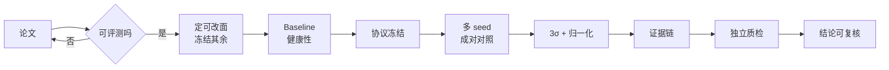

<div align="center">

# LLM 评测与推理效率

**把「怎么判断一个提升是真的」做成能跑的工具**

`评测协议设计` · `统计判定` · `推理加速实验` · `评测工具化`


</div>

---

## 我做过什么

2026 年下半年，我参与了一批 **agentic 评测任务包**的构建与质检，覆盖四个方向：视觉 token 削减、KV Cache 压缩、持续学习、投机解码。

我的活不是「跑 benchmark」，而是**把一篇论文变成一个能被公平评测的任务**：

- 判断论文适不适合做任务（数据是否可获取、指标是否可程序化、可改面是否大于调参、成本是否可承担）；
- 定义可修改的范围，冻结模型、数据与解码配置，让跑分差异只能来自方法本身；
- 论证 baseline 是「健康的」，而不是被悄悄做弱的；
- 冻结评测协议：seed 集、主指标、质量门、上锚点、验收区间，全部事先声明；
- 做多 seed 成对对照，用 3σ 与归一化评分判定改善是否成立；
- 打包可复核的证据链，最后过独立质检。

这段经历里最常出现的两类错误，被我做成了这个仓库里的代码：

> **一、统计口径错**：σ 用错、单位混用、事后调锚点 —— 结论会静默地偏向「通过」。
> **二、任务包静态缺陷**：答案文件进了选手目录、参考实现被复制进工作区 —— 运行时不会报错，只有质检能发现。

> 受协议限制，具体的题目、数据与分数不公开。这里保留的是**方法论**，以及能直接跑的**工具**。

---

## 我怎么判断一个结论



每一步都有对应的可运行实现，不是停留在流程图里。完整走一遍的示例在
**[`notes/05-case-study.md`](notes/05-case-study.md)**，里面还列了四个「看起来通过但不算数」的反例。

---

## 我能胜任什么

| 方向 | 我现在的位置 | 对应证据 |
|---|---|---|
| **大模型评测 / benchmark 工程** | 能独立设计一个任务的评测协议，并判定结论是否成立 | 这个仓库的 `notes/04`、`evalkit` |
| **推理效率实验（测量侧）** | 能读懂论文、设计对照实验、写可复现的测量脚本 | `notes/01–03`、`tools/` |
| **评测工具化 / 测试与数据自动化** | 能把人工判定写成带测试、能进 CI 的代码 | `evalkit`，43 个单元测试 |
| 推理内核 / 训练侧 | **暂时不能**，缺深度学习地基与大规模训练经验 | — |

一句话概括：**我不是「会调库」的人，我是「能定义什么叫好、并且知道结论在什么情况下不成立」的人。**

---

## 仓库里有什么

| | 内容 | 说明 |
|---|---|---|
| [`notes/`](notes/) | 5 篇笔记 | KV Cache 压缩、视觉 Token 削减、投机解码、评测方法论、端到端案例 |
| [`evalkit/`](evalkit/) | 评测判定与任务包自检 | `stats`（3σ、归一化评分）+ `lint`（13 条发布前检查），零第三方依赖 |
| [`tools/`](tools/) | 笔记配套小工具 | KV Cache 显存估算、NumPy 手写 Attention |
| [`tests/`](tests/) | 43 个测试 | 一条命令跑完，CI 覆盖 Python 3.11 / 3.12 / 3.13 |

---

## 上手

```bash
git clone https://github.com/wang2067562393-dot/llm-inference-efficiency-notes
cd llm-inference-efficiency-notes

# 判定一次「A 比 B 好」是否成立
python -m evalkit stats --baseline 12.4 12.1 12.7 \
                        --reference 8.9 8.7 9.1 \
                        --direction minimize --upper 0 --accept-range 0.15 0.8

# 发布前自检一个评测任务包
python -m evalkit lint tests/fixtures/leaky_task

# 跑全部测试
python -m unittest discover -s tests -v
```

```
Δ/σ_B           11.67   （门槛 3）  通过
归一化评分      0.2823   （上锚点 U=0.0）  区间内
```

---

## 边界

我宁愿把这条写在前面：

- **三篇方法笔记里的性能数字全部来自原论文**，这个仓库里没有我自己的大模型实测。下一步是用 0.5B 级模型把「估算」换成「测出来的」。
- `evalkit` 只覆盖**静态可判定**的一类问题（结构、泄漏、哈希），不检查「任务的方法空间是否真的成立」——那需要人判断。
- 3σ 是**验收口径**，不是假设检验；n=3 时它只提供「强/弱信号」，说「99.7% 概率有效」是错的。

---

## 现在在补什么

- **推理方法的原理**：挑一个方向（投机解码）自己实现一遍，测接受率与加速比的拐点，包括「draft 太小反而变慢」的负结果；
- **深度学习地基**：从零手写 MLP / CNN / Attention，每一块都要能解释梯度和显存。

<div align="center">

*If you can't measure it, you can't claim it.*

</div>
