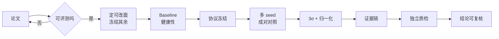

<div align="center">

# LLM 评测与推理效率

**把「怎么判断一个提升是真的」做成能跑的工具**

`评测协议设计` · `统计判定` · `推理加速实验` · `评测工具化`


**4 个评测方向 · 每题 3 个正式 seed · 双模型长程迭代 · 90 项独立质检**

</div>

---

## 工作背景

**算法工程实习生 · Harbor 科研评测方向**（2026.06 – 至今）

我的工作不是「跑 benchmark」，而是**把一篇论文变成一个能被公平评测的任务**：

- 判断论文适不适合做任务：数据和权重能否真正获取、指标能否程序化、可改面是否大于调参、单轮成本是否可承担；
- 定义可修改的范围，冻结模型、数据与解码配置，让跑分差异只能来自方法本身；
- 论证 baseline 是「健康的」，而不是被悄悄做弱的；
- 冻结评测协议：seed 集、主指标、质量门、上锚点、验收区间全部事先声明；
- 组织 baseline / reference / 候选的三方对照，打包可复核的证据链；
- 走独立质检与返修，直到题包能被别人接手复跑。

经手的四个方向，覆盖推理的两个阶段：

| 方向 | 阶段 | 可修改面 | 主指标类型 |
|---|---|---|---|
| KV Cache 压缩（ChunkKV） | Prefill | 一个 KV 选择策略 | 精确答案正确率 |
| 视觉 Token 削减（VisionZip） | Prefill | 一个 token 选择函数 | 提速比 |
| 视觉 Token 策略程序（ConiCo） | Prefill | 受限大小的策略程序 | 成本下降 |
| 投机解码（EAGLE-3） | Decode | 草稿深度调度 | ms/token |

四个任务的指标方向都不一样（越高越好 / 越低越好），质量门的形态也不同——这迫使我不能套一个模板，每一题都要重新对齐口径。

---

## 我在其中解决过的问题

这些是真实遇到、并且处理掉的，也是我认为比「用了什么框架」更能说明能力的地方：

**一、同一个策略，公开集很好，私有集崩了**
一个在公开集上质量几乎不掉、成本明显下降的方案，换到同规模的私有集上大幅掉点。
复盘出的结论是：**公开集只能用来选方法，私有集必须一次性验收、结果不回灌**。这条后来写进了我的评测纪律。

**二、共享 GPU 上的对照实验不可信**
H20 MIG 共享显存时，两个槽并发会让对照臂的基线漂移。处理办法是固定同卡同槽、成对相邻跑，并在记录里标注资源竞争。
这也是为什么 `evalkit` 里 3σ 用的是 **Baseline 的样本标准差**——它直接反映「同一方法换 seed 会漂多少」。

**三、环境问题会伪装成「方法无效」**
CUDA OOM、文件权限、镜像构建失败、容器内无法创建容器——这些都会让一次 run 直接没有分数。
区分「方法不行」和「环境不行」是评测工作的日常，不能混着写结论。

**四、空候选必须被拒绝**
我做过负向探针：提交一个什么都不改的候选，验证系统必须拒绝它、且不给任何 reward。
如果空方案能拿分，这个任务的所有分数都没有意义。

---

## 我怎么判断一个结论



每一步都有可运行的实现，不是停在流程图里。完整走一遍的示例在
**[`notes/05-case-study.md`](notes/05-case-study.md)**，里面还列了四个「看起来通过但不算数」的反例。

---

## 我能胜任什么

| 方向 | 我现在的位置 | 对应证据 |
|---|---|---|
| **大模型评测 / benchmark 工程** | 能独立设计一个任务的评测协议，并判定结论是否成立 | 这段工作经历 + `notes/04`、`evalkit` |
| **推理效率实验（测量侧）** | 能读懂论文、设计对照实验、写可复现的测量脚本 | `notes/01–03`、`tools/` |
| **评测工具化 / 测试与数据自动化** | 能把人工判定写成带测试、能进 CI 的代码 | `evalkit`，43 个单元测试 |
| 推理内核 / 训练侧 | **暂时不能**，缺深度学习地基与大规模训练经验 | 正在补 |

一句话概括：**我不是「会调库」的人，我是「能定义什么叫好、并且知道结论在什么情况下不成立」的人。**

---

## 仓库里有什么

| | 内容 | 说明 |
|---|---|---|
| [`notes/`](notes/) | 5 篇笔记 | KV Cache 压缩、视觉 Token 削减、投机解码、评测方法论、端到端案例 |
| [`evalkit/`](evalkit/) | 评测判定与任务包自检 | `stats`（3σ、归一化评分）+ `lint`（13 条发布前检查），零第三方依赖 |
| [`tools/`](tools/) | 笔记配套小工具 | KV Cache 显存估算、NumPy 手写 Attention |
| [`tests/`](tests/) | 43 个测试 | 一条命令跑完，CI 覆盖 Python 3.11 / 3.12 / 3.13 |

---

## 上手

```bash
git clone https://github.com/wang2067562393-dot/llm-inference-efficiency-notes
cd llm-inference-efficiency-notes

# 判定一次「A 比 B 好」是否成立
python -m evalkit stats --baseline 12.4 12.1 12.7 \
                        --reference 8.9 8.7 9.1 \
                        --direction minimize --upper 0 --accept-range 0.15 0.8

# 发布前自检一个评测任务包
python -m evalkit lint tests/fixtures/leaky_task

# 跑全部测试
python -m unittest discover -s tests -v
```

---

## 边界

我宁愿把这条写在前面：

- **这个仓库里的数字全部是合成的**。真实交付涉及委托方资产，不公开；这里只保留方法论与可复现的工具。
- 三篇方法笔记里的性能数字**来自原论文**，仓库里没有我自己的大模型实测。下一步是用小模型把「估算」换成「测出来的」。
- `evalkit` 只覆盖**静态可判定**的一类问题（结构、泄漏、哈希），不检查「任务的方法空间是否真的成立」——那需要人判断。
- 3σ 是**验收口径**，不是假设检验；n=3 时它只提供「强/弱信号」。

---

## 现在在补什么

- **推理方法的原理**：挑一个方向（投机解码）自己实现一遍，测接受率与加速比的拐点，包括「draft 太小反而变慢」的负结果；
- **深度学习地基**：不装框架，用 NumPy 从零手写感知机 → softmax/交叉熵 → 反向传播 → 两层 MLP，每一课都有测试对标。

<div align="center">

*If you can't measure it, you can't claim it.*

</div>
